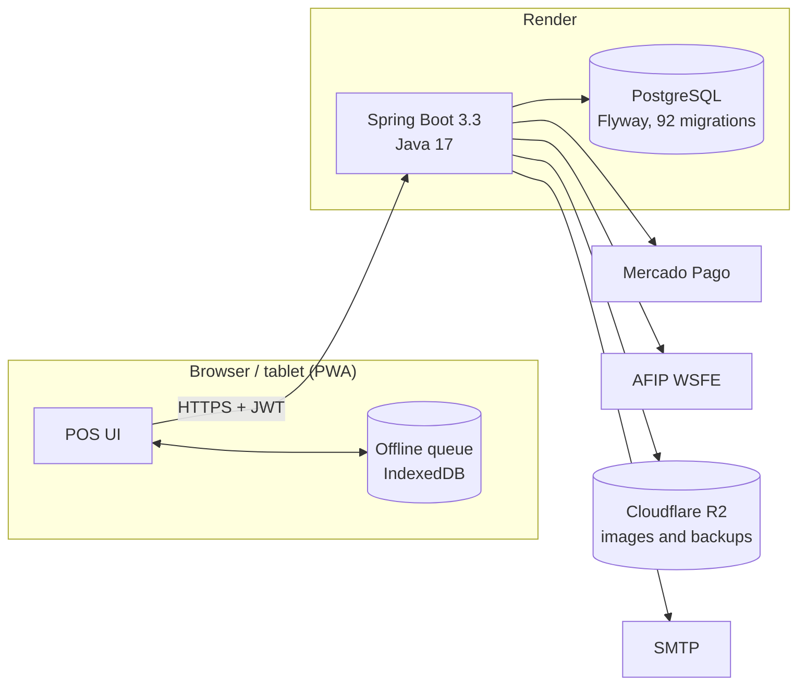

# Fluo — case study

**[getfluo.com.ar](https://getfluo.com.ar)** · Point of sale and management platform for cafés and restaurants in Argentina
Designed, built and operated by me, solo. **The source code is private** (it's a product); this document explains what it does, how it's built and what went wrong along the way. I'm glad to walk through the code in an interview.

<!-- TODO(Ian): 2–3 screenshots or a short GIF: tables view, a sale being charged, the QR menu. -->
<!-- TODO(Ian): real numbers if you have them: venues using it, orders/day, months in production. -->

---

## The problem

Small cafés in Argentina juggle a cash register, a spreadsheet, Mercado Pago, AFIP invoicing and WhatsApp orders. Commercial POS systems are expensive, need dedicated hardware, and stop working when the internet does. Fluo runs on the tablet or laptop the venue already has, and keeps selling offline.

## What it does

- **Front of house:** tables and floor plans, orders, split payments, tips, QR menu with table call and counter orders.
- **Payments and invoicing:** Mercado Pago (QR and checkout, per-venue credentials), AFIP electronic invoicing (WSFE / CAE).
- **Back office:** stock and recipes (ingredient costing), suppliers and purchase orders, cash register shifts, fixed costs, finances across branches.
- **Customers:** loyalty program, reservations, reviews, web push notifications to staff.
- **Accounts:** owners with multiple venues/branches, employees who log in with a PIN, email verification, TOTP 2FA, password reset.

## Architecture

| | |
|---|---|
| Backend | Java 17, Spring Boot 3.3 (Web, Security, Data JPA, Validation, Mail, Actuator) |
| Data | PostgreSQL, Flyway (92 migrations), Hibernate filters for tenancy |
| Security | JWT with revocation (token versioning), BCrypt, TOTP 2FA, Bucket4j rate limiting, AES-256-GCM for stored credentials |
| Frontend | Vanilla JS PWA (~30k lines), service worker, offline queue |
| Ops | Docker, Render (blueprint in `render.yaml`), Prometheus metrics via Micrometer, OWASP Dependency-Check |
| Tests | JUnit 5 + Testcontainers (real PostgreSQL), plus browser test benches for the offline queue |
| Size | 576 Java classes, 70+ REST controllers |

## Decisions worth explaining

### 1. Tenant isolation at the ORM layer, not in every query
Every venue's data lives in the same database. Instead of trusting each repository method to remember `WHERE local_id = ?`, a servlet filter reads the venue id from the JWT, stores it in a `ThreadLocal` and enables a **Hibernate filter** on the session, so *every* query in the request is scoped automatically — including ones written later by someone who forgot. The context is cleared in a `finally` so pooled threads never leak a tenant.
The few legitimate cross-tenant reads (super-admin dashboards) go through a `TenantBypass` helper that only returns DTOs, never entities — a returned entity could lazy-load outside the bypass and silently come back filtered.

### 2. Third-party credentials are encrypted per tenant
Each owner connects their own Mercado Pago and AFIP accounts. Those secrets are stored encrypted with AES-256-GCM; the keys come from the environment, and a startup validator refuses to boot in production if any secret is missing or still a placeholder.

### 3. Single replica, on purpose
Login and webhook rate limits use Bucket4j **in memory**. With two replicas each would keep its own counters and an attacker could spread a brute-force attack across them. Rather than pretend to scale, the deployment pins one instance and the docs say exactly what to change (Redis-backed buckets) before adding a second one.

## Things that went wrong (and what I changed)

### A login bypass in email verification
`verify-code` returned the user **without checking the code** whenever the email was already verified, and the auth service then issued an owner session for it: anyone who knew a registered email could log in as that business owner, no password needed. While fixing it I found a second bug: the failed-attempt counter was rolled back together with the failing transaction, so the 5-attempt limit **never triggered**. Fixed with a dedicated exception type marked `noRollbackFor` at both transactional levels, so the counter is persisted even when the request fails.

### The offline queue was silently deleting sales
The sync engine treated any non-network error as a business conflict and dropped the operation. A 500 during a server restart, a 401 from an expired token, or a 409 for insufficient stock would make **sales already paid in cash disappear** from the books. Now errors are classified: network, 401, 5xx, 408 and 429 are retryable and keep the queue; only a business 4xx removes an operation, and even then it goes to a visible **quarantine** with manual retry. An operation stuck for 8 attempts is quarantined so it doesn't block the rest. A stock 409 is re-sent as forced — offline, the goods already left and were paid for; rejecting the sale doesn't return them to the shelf, it only erases them from the accounting. Verified with an 18-case test bench against the real queue.

### We lost the production database
Render's free PostgreSQL expires after ~30 days and is then deleted. In September 2026 that happened, with no backup, and the data had to be rebuilt from scratch. Since then: paid database with managed daily backups, a second off-site layer (a `pg_dump` script that uploads to S3-compatible storage such as Cloudflare R2), written RPO/RTO targets (24 h / < 1 h) and a documented monthly restore test, because a backup that was never restored isn't a backup.

### Cold starts made the POS think the server was down
On the free tier the backend took **94 s** to wake up, and the POS read that as an outage. Short term: two failed pings before declaring the backend down and a longer ping timeout. Long term: moved the web service to an always-on plan, because for a POS a 90-second cold start isn't acceptable.

## What I'd do next

- Redis-backed rate limiting to allow more than one instance.
- Dual-key JWT validation, so the signing secret can be rotated without logging everyone out.
- Split the frontend into modules with a build step; at ~30k lines of vanilla JS it's the part that slows me down the most.

---

Ian Schaschin · [GitHub](https://github.com/ISch-1) · [LinkedIn](https://www.linkedin.com/in/ian-schaschin-0554aa370/) · ischaschin@gmail.com
